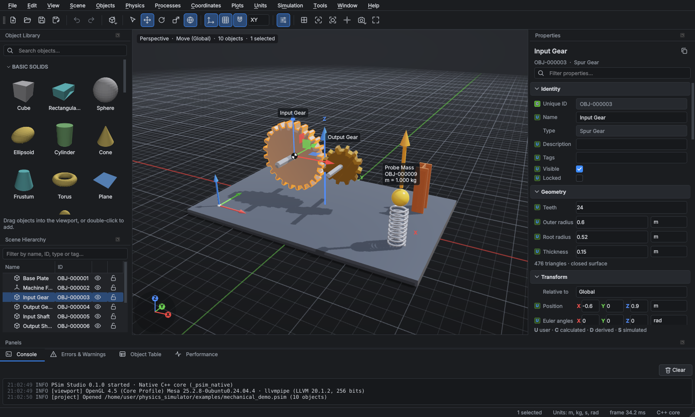
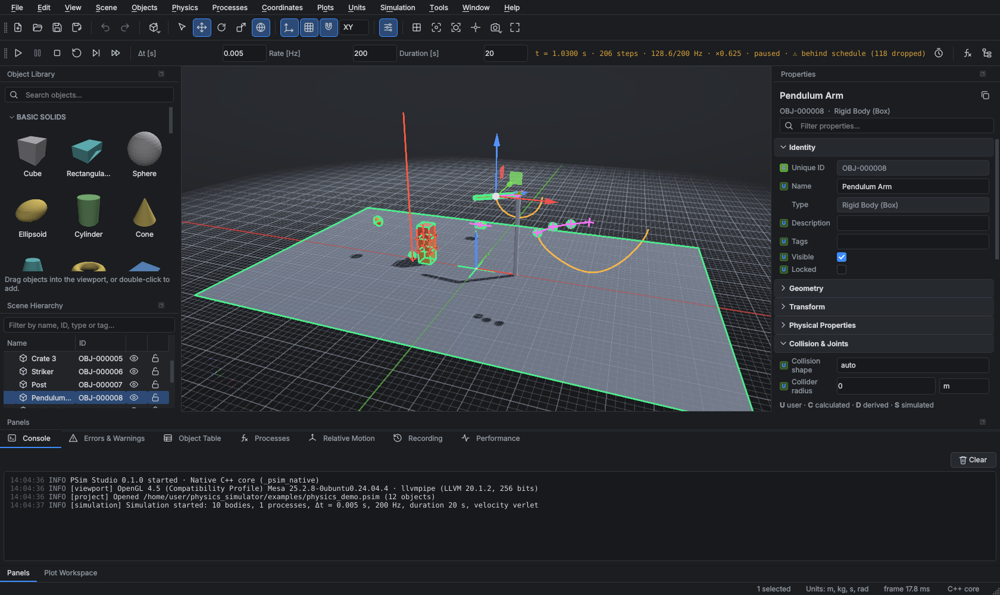

# PSim Studio — Professional 3D Physics Simulation Studio

PSim Studio is a desktop 3D physics simulation studio. It is written in Python (PySide6 / Qt 6)
with a C++17 numerical core bound through pybind11.

Implemented so far:

- **Phase 1**, a working desktop application:
  - a real OpenGL 3D viewport
  - a searchable object library with real 3D thumbnails
  - drag-and-drop placement
  - an undoable, typed property system with custom properties
  - coordinate axes, configurable grids and transform gizmos
  - project save/load with autosave and recovery
- **Phase 3**, the simulation engine:
  - a fixed Δt that is independent of the real-time update rate
  - a worker thread with a monotonic scheduler, bounded catch-up and overrun reporting
  - as-fast-as-possible mode
  - explicit Euler, semi-implicit Euler and RK4 integrators
  - built-in kinematics and dynamics processes with read/write declarations and conflict detection
  - Start/Pause/Resume/Stop/Reset/Single-Step, breakpoints and live parameter changes
- **Phase 4**, the formula and process engine:
  - a safe formula language (own parser and compiler, no `eval`) with static type and
    dimensional analysis and unit literals such as `9.81[m/s^2]`
  - formula-defined contribution, prescribed and discrete *update* processes, with
    dependency ordering, project-wide global parameters and custom-property outputs
  - developer-only authoring: a passphrase-protected developer role, a sealed process registry
    that enforces it, and Ed25519-signed process packages
- **Phase 5**, coordinates and units:
  - named reference frames, fixed or attached to objects and assemblies, usable for poses, vector
    components, formulas (`frame("FRM-0001")`) and a Relative Motion panel
  - a strict separation of *expressing* a vector in a frame (rotation only) from motion *relative to*
    a moving frame (transport, Euler, centripetal and Coriolis terms), checked against finite differences
  - derived custom units from unit expressions and a Formula Unit Inspector
- **Phase 6**, data recording, trajectories and plots:
  - a data recorder sampling every N simulation steps (independent of Δt and the render rate)
    with time-consistent values, process outputs, an event log and bounded memory
  - per-object trajectory markers (global or relative to any frame) and vector-arrow overlays
  - a plotting workspace with 2D and 3D plots, live updates, synchronized cursors and export
  - statistics, comparison between objects, CSV/JSON export and an HTML simulation report
- **Phase 7**, advanced physics:
  - rigid-body dynamics with the gyroscopic term (Euler's equations), plus midpoint, velocity
    Verlet and adaptive Dormand–Prince 5(4) integrators
  - collision detection (sphere, box, capsule, plane and convex-hull colliders kept separate from the
    visual mesh)
    and response with restitution and Coulomb friction, resting contact and stacking
  - fixed, ball, revolute, prismatic and distance (rod/rope) joints with limits and motors, solved by
    a C++ projected Gauss–Seidel core with block solves and split-impulse position correction
  - central gravity, region force fields and anchored spring-dampers; the Joints dialog, an inspector
    *Collision & Joints* section and viewport drawing of colliders, joints and contacts
- **Phase 8**, testing and distribution:
  - an acceptance suite with one end-to-end test for each of the 30 mandatory acceptance tests
    (`docs/acceptance.md`)
  - conditional stop events (formulas that pause or end a run), saving and restoring simulation
    states with bit-for-bit continuation, live distance/angle measurements, and headless batch
    runs with parameter overrides
  - per-stage engine profiling, a crash-report and log system, and Help ▸ System Information
  - GUI responsiveness under heavy runs (frame pacing and snapshot backpressure)
  - packaging: a platform wheel with `psim-studio` / `psim-batch` commands, a PyInstaller bundle,
    a Linux `.tar.gz` and `.deb` (built and tested here), and an Inno Setup script for Windows
    (not built here)
  - a user guide, developer guide and file-format reference in `docs/`



---

## 1. Quick start

```bash
pip install -r requirements.txt          # PySide6, PyOpenGL, NumPy, pybind11, pytest, pytest-qt
python build_native.py                   # builds + tests the C++ core, installs it into psim/numerics/
python app.py                            # launch
python app.py examples/mechanical_demo.psim
python app.py --template simulation      # start from a built-in project template (also: primitives, mechanical,
                                         # formulas, frames, recording, physics)
python app.py examples/simulation_demo.psim   # then press F5 (Start)
python app.py examples/formula_demo.psim      # formula processes, global parameters, custom outputs
python app.py examples/frames_demo.psim       # reference frames: open Coordinates ▸ Relative Motion Panel, F5
python app.py examples/recording_demo.psim    # trajectories and six ready-made plots (Plots ▸ Plot Workspace), F5
python app.py examples/physics_demo.psim      # collisions, a stack, a hinge, a rope chain and a motorised slider, F5
python app.py examples/measurements_demo.psim # live angle/distance measurements; a stop condition pauses the run
python -m psim.batch examples/physics_demo.psim --duration 2 --csv out.csv   # headless run (see docs/user_guide.md §9)
```

Installed packages (wheel, `.deb`, Windows installer) provide the commands `psim-studio` and
`psim-batch`; see *Packaging* in `docs/developer_guide.md`. The **user guide** is
`docs/user_guide.md`.

Options: `--theme dark|light`, `--no-recovery`, `--reset-settings`, `--version`.

**Windows.** You need Python ≥ 3.10 (64-bit), Visual Studio 2019+ ("Desktop development with
C++") and CMake ≥ 3.18. Run the same commands from a *Developer PowerShell*. `build_native.py`
copies `_psim_native*.pyd` next to the Python package.

**If the native core is not built**, the application still runs on an equivalent NumPy
implementation of every routine. The status bar then shows *NumPy fallback*, the console logs a
warning, and *Help ▸ About* names the active backend. The test suite checks that both
backends give the same results.

**Graphics requirement:** OpenGL 3.3 core profile, which any GPU driver from the last decade provides.

## 2. Tests

```bash
python -m pytest                 # Windows / Linux desktop
xvfb-run -a python -m pytest     # headless Linux (GUI tests need an OpenGL display)
ctest --test-dir native/build    # C++ unit tests (also run by build_native.py)
```

| Suite | What it verifies |
|---|---|
| `test_native.py` | C++ core ≡ NumPy fallback (quaternions, poses, matrices, ray casting, normals, feature edges, mass properties) |
| `test_objects.py` | every registered type builds valid, outward-oriented geometry; volumes vs. analytic formulas; inertia tensors (box, sphere, cylinder, thin plate); mass modes; registry validation; OBJ import |
| `test_properties.py` | typed coercion and validation, custom properties (keys, ranges, types), property paths, read-only rules |
| `test_units.py` | conversions, incompatible-dimension errors, custom units, preferences, per-property display units; unit expressions (superscripts, negative exponents), SI names of dimensions, custom units defined from expressions, formula unit inspection and process unit requirements, Units and Formula Unit Inspector dialogs |
| `test_coordinates.py` | Euler convention, gimbal lock, global ↔ local poses through hierarchies, relative-frame representation |
| `test_editing.py` | unique persistent IDs (never reused), undo/redo of every edit type, group/ungroup, clipboard, align/distribute, parallel-axis combination |
| `test_project_io.py` | save/load round trip, rejection of malformed/unsupported/unsafe files, warnings, example projects |
| `test_update_rate.py` | Phase 3 timing contract: Δt independent of update rate, exact step counts, duration-boundary policies, no clock drift over 10⁶ steps, bounded catch-up, overrun reporting |
| `test_interaction_math.py` | camera projection/rays, picking, surface/plane placement, gizmo translate/rotate/scale with snapping |
| `test_gui.py` | app launch and menus, real 3D rendering (pixel checks, shading, shadows), drag-and-drop, click selection, gizmo drag + undo, inspector editing, display units, save/reopen, themes, camera follow modes |
| `test_simulation.py` | §9.9: step counts, Δt per step, duration-boundary policies, Δt changes, bitwise determinism, independence from render FPS **and** pacing mode, real-time rate (100 Hz × 0.001 s ⇒ 0.1×), unachievable-rate reporting with Δt unchanged, pause/step/breakpoints, live changes, instability detection, integrator regressions (closed-form Euler errors, RK4 4th-order convergence, symplectic energy behaviour) |
| `test_processes.py` | every built-in process against analytic solutions (constant velocity/acceleration, F = ma, torque, damping decay, projectile range, circle, oscillation, rotations, spring period and momentum, COM offsets), conflict and eligibility diagnostics, summation, targets by type/tag, undoable assignments |
| `test_formulas.py` | formula parser (precedence, unit literals, error positions), type and dimension checking, runtime semantics and domain errors, aggregates, scripts (`let`/`require`/targets), test-case runner |
| `test_formula_processes.py` | library processes in the engine against analytic results (discrete update rules ≡ semi-implicit Euler bit-for-bit, N-body circular orbit, drag terminal velocity, prescribed Lissajous with numerical rates, kinetic-energy output), required globals, update dependency cycles, missing writers and references, error policies; permissions (sealed registry, wrong passphrase, forged token), signing, tamper and untrusted-key rejection, version rules, withdrawal, developer CLI, projects that try to embed formulas |
| `test_developer_gui.py` | developer-mode unlock, process editor (refuses without token, validate with line highlighting, tests, sign & publish), global-parameters dialog with unit conversion |
| `test_frames.py` | relative position/velocity/acceleration and relative rotation against finite differences in translating and non-uniformly rotating frames (ω ∦ α), points fixed in a frame, representation vs. relative velocity, named-frame validation, attached/translating frames, poses edited in frames, undo, project files, kinematics of children of simulated assemblies, frames and `rel_velocity` in formulas and the engine, unsimulated objects at rest |
| `test_coordinates_gui.py` | Reference Frames dialog (one undo step, re-attaching and toggling rotation keep the frame in place, duplicate names), inspector poses and vector components in a named frame, Relative Motion panel on a turntable before and during a run |
| `test_recording.py` | sampling every N steps incl. the final state, recording never changes the simulation, coarse recordings are exact subsets of fine ones, accelerations consistent with sample times (finite differences, prescribed and discrete-update bodies), per-process outputs sum to the total, carried children, custom outputs, decimate/window/stop policies, no duplicated skip warnings |
| `test_recording_analysis.py` | frame-relative position/velocity/acceleration from recordings against finite differences, Euler angles, net force/torque, kinetic energy, process forces, time-weighted statistics (uneven sampling), object comparison, CSV/JSON/trajectory export, HTML report, consistent snapshots while recording grows |
| `test_trajectories.py` | path thinning (interval, maximum points, recent history), incremental vs. full builds, clear/preserve, relative paths attached to the frame's current pose, cache invalidation after decimation, arrows/time-label marks, vector arrows, label units, placement and angular acceleration |
| `test_plots.py` | plot definitions (round trip, validation), series data in display units, axis titles, cursor read-out, plot editor, workspace (live data, synchronized cursors, save/restore, CSV and image export), recording panel, plots saved in projects |
| `test_rigid_dynamics.py` | orders of convergence of all six integrators, Dormand–Prince keeps the fixed Δt, long-term energy of velocity Verlet, torque-free rotation (angular momentum and energy conserved, intermediate-axis flip) and the effect of disabling the gyroscopic term |
| `test_physics_model.py` | colliders are explicit and separate from the mesh (mass alone never collides), joint anchors stored in local frames, joint validation, joints and physics settings in project files |
| `test_physics.py` | bounce height e²·h, resting box with zero net force, sliding distance v²/(2μg), stick/slip on an incline, static friction holding a block that kinetic friction alone would let slide (and sliding once pushed), stable stack, momentum and elastic energy in collisions, a kinematic platform carrying a box, physical-pendulum period, point mass on a rod, prismatic slider, fixed joint, motor speed and limits, slack/taut rope, compound assemblies, ownership rules, disabling physics, C++ ≡ NumPy PGS (incl. separate impulse directions), energy of a large-swing pendulum |
| `test_force_models.py` | circular orbit under central gravity (radius, period, μ/r²), softening at the centre, a force field acting only inside its region or everywhere, anchored-spring oscillation z(t), torque from an off-centre attachment |
| `test_physics_gui.py` | Joints dialog (world anchors and axes → local frames, limits, rope length from anchors, one undo step, rejecting body A = body B), inspector Collision & Joints section, solver fields of the Simulation Settings dialog, collider/joint/contact overlay geometry, contacts in engine snapshots, Physics menu and overlay toggles with rendering |
| `test_acceptance.py` | the 30 mandatory acceptance tests of the specification, end to end (traceability in `docs/acceptance.md`) |
| `test_conditions.py` | stop conditions: stop/pause at the right step, fire once per false→true transition, dimension/type/reference checks, global parameters, settings round trip; per-stage profile |
| `test_sim_state.py` | saved simulation states: bit-for-bit continuation (with collisions, joints and formula processes), recording truncation, rejection of foreign/invalid states, save/restore through the session controller |
| `test_batch.py` | headless batch runs: CSV/JSON/report/state outputs against analytic values, property and global overrides, restore-and-continue, stop conditions, exit codes for invalid input and numerical failure; sweeps (value syntax, grid order, numbered files, final values against z₀ + v·t − g t²/2, parallel ≡ serial, a bad value fails only its run) |
| `test_placement.py` | Place Relative To: offsets along the reference's or the global axes, relative orientation, round trip with the current placement, rigid groups with children, one undo step, invalid references (itself, children, attached frames, missing), locked objects, the dialog and its menu action |
| `test_measurements.py` | distance and angle values (precise near 180°, undefined at the vertex), centre-of-mass points, surface points that follow motion, rotation and scale, snapping to corners and real edges but not to the seam of a flat face, point validation, undo, dangling objects, project files, viewport overlays, Measurements panel |
| `test_crash.py` | log file, crash reports from the main and worker threads, system information dialog |
| `test_phase8_gui.py` | Stop Conditions dialog, stage profile in the Performance panel, box selection (rectangle hit test and a real drag in the viewport), measuring between surface points by clicking in the viewport (empty clicks ignored, Esc cancels, selection unchanged) |
| `test_packaging.py` | package metadata and entry points, package data, PyInstaller spec, desktop/MIME files, Windows installer script |
| `test_decompose.py` | exact, closed cuts (volumes add up, caps close the pieces), hull volumes robust to coplanar points under rotation, decomposition quality (cylinder 1 part, I-beam, torus), C++ ≡ NumPy decomposition, compound colliders (auto/convex/convex parts, one solver entry per part), a ball falls through the hole of a torus that rests flat |
| `test_hulls.py` | convex hulls (exact box/prism hulls, flat inputs, reduction of detailed meshes, packing), a cylinder on its side rolling at v = ω·r, a cone standing on its base, stacked cylinders at rest, C++ hull contacts ≡ NumPy reference |
| `test_joint_springs.py` | torsion spring period 2π√(I/k), slider spring amplitude v₀/Ω and period, damped envelope A·e^(−ζΩt), soft distance joint stretching by mg/k, a 10¹² N/m spring staying stable, joints breaking above (not below) their force, a torque-limited cantilever and its saved state, validation |
| `test_joint_kernel.py` | C++ joint rows ≡ NumPy reference for random joints of every type (limits near both ends, motors, ropes, world anchors, with and without the midpoint Jacobian), row counts and blocks per joint type, slack and taut ropes, rotation vectors, input validation |
| `test_contact_kernel.py` | C++ collision pipeline ≡ NumPy reference on random scenes (pairs, contacts, rows, every shape-pair kind, speculative contacts, static friction), sort-and-sweep keeps every overlapping pair (also in scenes stretched along x, y or z), input validation; continuous collision detection: a 100 m/s ball tunnels through a 2 cm wall without it, stops (or bounces with e·v) with it; a fast box lands on a thin plate |
| `test_simulation_session.py` | session semantics (run → stop → undo → reset), exact reset, live edits applied at the next step, invalid plans, single step, assignment round-trip, v1 project compatibility, GUI toolbar/inspector integration |

Current result: **584 Python tests and the C++ test executable pass** with the native core.
With the NumPy fallback, 501 pass and 83 native-comparison tests are skipped. This was measured on
Linux with Mesa llvmpipe under Xvfb. Windows has not been tested yet; see §6.

## 3. What Phase 1 implements

**Application shell**
- Menu bar with all 14 requested menus. During Phases 1–6, features of later phases were shown as
  *disabled "Planned: …" entries*; with Phase 7 the last of these was replaced by working
  commands. Nothing non-functional is presented as working.
- Main toolbar: New/Open/Save/Save As, Undo/Redo, Add Object, Select/Move/Rotate/Scale,
  global/local gizmo, coordinate axes, grid, snapping, work plane, properties, camera controls,
  full screen.
- Dockable, hideable and resizable panels. Named workspace layouts (save, restore, reset).
- Graphite dark and light themes, a vector SVG icon set and high-DPI support.
- Customizable keyboard shortcuts with conflict detection, and context menus in the viewport and outliner.

**3D viewport** (`psim/rendering`)
- OpenGL 3.3 core renderer:
  - GGX/PBR-style shading (metallic, roughness, opacity) with a key light, fill light and environment reflection
  - directional shadow mapping (PCF) plus a ground-shadow catcher
  - 4× MSAA
  - transparency sorting, wireframe mode and feature-edge rendering
- Camera:
  - orbit, pan and zoom-to-cursor
  - perspective/orthographic, front/back/left/right/top/bottom and isometric views
  - frame selected, fit scene, focus on origin
  - bookmarks
  - follow, look-at and track-local-frame modes (camera only; objects are never modified)
- Independent XY/YZ/XZ grids: colour, opacity, major spacing, subdivisions, extent, thickness,
  labels and origin emphasis. Lines are anti-aliased screen-space quads, so thickness works
  in a core profile.
- Global axes with configurable colours, length and thickness, plus labels, an origin marker and a view triad.
- Per-object overlays:
  - name, ID, position, orientation, velocity, acceleration, angular velocity, mass, force, torque and custom properties
  - local axes, bounding box and centre-of-mass symbol
  - per-object font size, precision and colour, and the project display units
- Selection highlight and hover, ray picking (native C++), and Ctrl/Shift multi-select.
- Transform gizmos: axis, plane and view-plane move; axis rotate; axis and uniform scale.
  They work in global or local orientation with grid, rotation and scale snapping, show a live
  readout, are a single undo step per drag, and Esc cancels.
- Drag-and-drop from the library with a ghost preview. The object is placed resting on the
  surface under the cursor (surface snapping) or on the chosen XY/YZ/XZ work plane, with grid snapping.

**Object library and types** (`psim/scene`, `psim/gui/object_library.py`)
- 29 registered types, each with real triangulated geometry and normals:
  - **Basic solids:** cube, cuboid, sphere, ellipsoid, cylinder, cone, frustum, torus, plane,
    disk, capsule, pyramid, prism, hemisphere, plus a wedge from the example plugin
  - **Mechanical:** spring, rope/cable, spur gear, I-beam, pulley
  - **Bodies:** point mass, rigid body (box, cylinder)
  - **Reference frames:** reference frame, coordinate marker
  - **Vectors & measurement:** line segment, vector arrow
  - **Groups:** assembly
  - **User-defined:** custom polygonal mesh (Wavefront OBJ import)
- Composite templates: dumbbell, wheel & axle, simple pendulum, spring-mass and gear pair.
  User templates come from *Objects ▸ Save as Template*.
- The thumbnails are software-rendered from the actual meshes. The library is searchable and has collapsible categories.
- Extension API: `ObjectRegistry.register(ObjectTypeDef(...))`. Plugins in `psim/plugins/`
  are loaded at start-up (see `example_wedge.py`). Project files can never register or run code.

**Objects, properties and editing**
- Unique, persistent IDs (`OBJ-000001`, …). They are never reused, survive renames and edits,
  and duplicates are rejected on load.
- Inspector sections:
  - **Identity, Geometry and Transform**, the transform shown relative to the global frame, the parent or any object
  - **Physical Properties:**
    - mass from density or mass, physical material presets
    - volume or area, centre of mass, inertia tensor and principal moments, computed by exact
      polyhedral integration of the faceted mesh in C++
    - initial velocities, accelerations, force and torque
    - derived momentum, angular momentum and kinetic energy
  - **Coordinate Systems:** parent, global and local pose, local axes
  - **Materials & Appearance**
  - **Labels & Display**
  - **Custom Properties:** float, int, bool, string, 2D/3D vector, with unit, description,
    default, read-only flag, precision, min/max validation and sorting
- Every value carries a **U/C/D/S** badge (user-controlled, calculated, derived, simulated). The inspector
  has a property filter, per-property display-unit selectors and multi-object editing.
- Scene hierarchy outliner:
  - drag-to-reparent with cycle protection, visibility and lock toggles, filtering
  - group/ungroup, duplicate, copy/cut/paste, delete, rename
  - align (min/centre/max) and distribute, hide/show/lock
  - *Objects ▸ Place Relative To…*: a numeric offset from another object, a named frame or the
    origin, along the reference's axes or the global axes, optionally with an orientation relative
    to the reference; several selected objects move as one rigid group, in one undo step
- Undo/redo for every edit through before/after object snapshots, plus a history panel.
- Bottom panels: Console, Errors & Warnings, Object Table (sortable, filterable, CSV export) and
  Performance (frame time, draw calls, triangles, sparkline).
- Mass properties report: combined mass, combined centre of mass and inertia via the parallel-axis theorem.

**Units** (`psim/units`): SI canonical storage and dimension vectors (with an angle pseudo-dimension).
- About 100 units across all requested quantities.
- Project preferred units, per-property display units, and custom units with conversion
  factors. Incompatible conversions raise errors.

**Projects** (`psim/project`)
- Versioned JSON `.psim` format (documented in `serialization.py`).
- It stores objects, hierarchy, custom properties, mesh assets, units, grids/axes/snap/lighting,
  camera and bookmarks, simulation settings and the UI layout.
- Loading validates everything, and a failed load leaves the open project untouched. Saves are atomic.
- Autosave to a recovery file with a restore offer after a crash, recent files, project
  templates, OBJ import/export and CSV export.

## 3b. What Phase 3 implements (simulation engine)

**Controls.**
- A **Simulation toolbar** has Start/Resume (F5), Pause (F6), Stop (Shift+F5), Reset
  (Ctrl+F5), Single Step (F10) and Run as fast as possible.
- Separate **Δt**, **Update rate (Hz)** and **Duration** fields sit alongside a live read-out of
  simulated time, completed steps, actual/requested rate, simulation speed (simulated s per
  real s), state, and a *behind schedule* warning with the dropped-step count.
- **Simulation ▸ Simulation Settings** adds:
  - the duration-boundary policy and the integrator
  - the maximum catch-up steps and the render rate
  - breakpoints at simulated times
  - the derived quantities: expected step count and rate × Δt
- The Performance panel and the viewport HUD show the same timing figures.

**Engine** (`psim/simulation`).
- A deterministic step loop implements §9.4: shared previous state, plan-ordered evaluation,
  atomic state replacement, clock advance by Δt, and the step counter.
- Integrators: explicit Euler, semi-implicit (symplectic) Euler and RK4. Processes are
  evaluated at each solver stage.
- Hot kernels run in C++: linear integration, the quaternion exponential map, and batched
  rotation of vectors and inertia tensors.
- The translational state is the centre of mass. Prescribed motion is defined for the object origin.
- Non-finite or exploding values stop the run with a diagnostic.

**Runner.**
- A worker thread with its own monotonic scheduler, separate from rendering.
- Commands are queued and applied between steps, so changes to Δt, rate, duration, pacing,
  object properties or process parameters never affect a half-finished step.
- Snapshots go to the GUI at the render rate and nothing more often, so rendering FPS never
  alters Δt or the number of steps.
- If the engine falls behind, it runs at most N catch-up steps per tick and reports the rest as
  dropped. Δt is never changed.
- On Windows the runner requests 1 ms timer resolution during a run.

**Processes** (`psim/processes`).
- Approved process definitions carry an ID, version, category, description, formula,
  parameters with units, reads/writes, eligibility, mode (per-object or global), preconditions
  and error handling.
- Built-ins:
  - **Kinematics:** constant velocity, constant acceleration, prescribed circular motion,
    prescribed harmonic oscillation
  - **Rotation:** about a fixed global axis, about an object-local axis
  - **Dynamics:** uniform gravity (projectiles), applied force and torque (Newton's second law
    with world-frame inertia), viscous damping, and a two-body spring-damper (a global process)
- Assignments target objects by ID, type or tag. Their parameters are editable, they are
  undoable, and they are saved in the project (file format v2, which still reads v1).
- A **Processes** panel (the Process Table) lists assignments in evaluation order with enable
  toggles. It provides validation, a **dependency and diagnostics viewer** (reads/writes per
  process and writers per object) and process documentation. The inspector has an **Assigned
  Processes** section.
- Conflict rules:
  - force and torque contributions are summed
  - two prescribed writers of the same quantity are a conflict
  - a per-object force on a prescribed body is a conflict
  - a global (multi-body) force on a prescribed *driven anchor* is ignored with a warning
- Other diagnostics: missing references, ineligible targets and invalid parameters are
  reported before the run, and a simulated object inside a simulated assembly is rejected.

**Session semantics.**
- During a session, edits apply live, undo is disabled, and structural edits are blocked.
- *Stop* records the whole run as one undoable step.
- *Reset* restores the exact state captured at Start.
- Inspector values owned by the running simulation show the **S** badge. The current total
  acceleration is shown live in the inspector and labels.

## 3c. What Phase 4 implements (formulas, processes, permissions)

**Formula language** (`psim/processes/formula_*.py`, `dimensional_analysis.py`).
- Hand-written lexer and Pratt parser to an AST, a static checker, and a compiler to Python
  closures. Nothing is ever passed to `eval`/`exec`; only whitelisted functions, attributes and
  constants exist. Sources are limited to 10 000 characters and nesting depth is bounded.
- Types: number, vec2, vec3, mat3, quaternion, bool, object, object set, string. Every number
  carries an SI dimension. `+`, `-`, comparisons and function arguments must agree
  dimensionally, so `self.position + self.velocity` is rejected *before* the run, with line,
  column and a caret. Literal `0` is compatible with any dimension.
- Unit literals (`2.5[km/h]`, `9.81[m/s^2]`, `30[deg]`) are converted to SI at compile time.
  Angles are dimensionless inside formulas (radians).
- Built-ins: vector/matrix/quaternion algebra, `norm`, `normalize`, `dot`, `cross`,
  trigonometry, `clamp`, `lerp`, `if(c, a, b)`, frame transforms (`to_local`, `to_global`, `point_to_local`, `point_to_global`, `rotate`),
  aggregates `sum_of / mean_of / min_of / max_of / count` over `others`, `targets`,
  `tagged("…")` or `of_type("…")`, and `object("OBJ-…")` references.
- Domain errors (division by zero, `sqrt` of a negative, normalising a zero vector, non-finite
  results) raise a diagnostic naming the process, the object and the expression.

**Scripts and processes** (`formula_process.py`).
- A script is a list of `let name = expr`, `require cond : "message"` and `target = expr`
  lines. The allowed targets depend on the kind:
  - *contribution*: `force`, `torque`, `acceleration`, `angular_acceleration` (summed with
    other contributions)
  - *prescribed*: `position` (+ optional `velocity`), `orientation` (+ optional
    `angular_velocity`). If the rate is omitted it is computed by a central difference.
  - *update*: discrete-time assignments to `position`, `velocity`, `orientation`,
    `angular_velocity` or `custom.<key>`, applied after integration. They read the state at
    the start of the step, or the value already updated this step with `updated(self.velocity)`.
- Per-object processes see `self`; global processes see `targets[i]` and write
  `targets[i].force`, etc.
- Specs declare parameters with quantities and ranges, required **global parameters** (name,
  type, quantity), required custom properties, `after` dependencies, an error policy (`stop`
  the run, or `skip` this object this step and report it) and embedded **test cases**.
- **Process library** (`psim/processes/library/*.json`, loaded at start-up and only if every
  test passes): quadratic drag, wind drag (global `air_density` and `wind`), N-body gravity,
  periodic force, tether (global spring-damper), Lissajous path (prescribed), discrete Euler
  velocity/position/angular-velocity/orientation updates and a kinetic-energy monitor that
  writes `custom.kinetic_energy`.

**Scheduler additions.**
- Update processes are topologically ordered from `after` and `updated()` references.
  Cycles, `updated()` of a quantity no process updates, missing object references and missing
  or wrongly-typed globals are errors before the run.
- An update process that writes velocity or position cannot be combined with forces on the
  same object (the integrator would also move it). Velocity updated without position is
  reported as a warning.

**Global parameters.** *Processes ▸ Global Parameters…* edits project-wide named values
(float or vec3, with a quantity, shown in display units). They are undoable, saved in the
project and applied live during a run.

**Permissions and signing** (`permissions.py`, `packages.py`, `process_registry.py`, `devtools.py`).
- The default role is *user*: users select, configure and run approved processes only.
  Project files contain only process IDs and parameter values. An assignment with any extra
  field (e.g. an embedded script) is rejected on load.
- Developer credentials are created **outside the GUI**:
  `python -m psim.devtools init-developer --author "Name"`. This stores a PBKDF2-SHA256
  passphrase verifier and an Ed25519 signing key encrypted with the passphrase in the user's
  data directory. Other commands: `show-public-key`, `trust-key`, `list-trusted`, `verify`.
- *Tools ▸ Developer Mode…* unlocks a session token. Only then does the **Developer** menu
  appear (New Formula Process, Edit Formula Process (new version), Withdraw Published Process).
- The process registry is **sealed** after start-up. `register`, `publish` and `withdraw`
  verify the token themselves, so the GUI is not the enforcement point. Publishing requires
  validation, passing tests and a higher version, cannot replace built-in or library
  processes, and writes a signed `.psimproc` package.
- At start-up only packages signed by a trusted key with a valid signature are loaded. Edited
  or foreign packages are reported and ignored.
- The **Process Editor** has metadata, a parameter table, globals/custom/test JSON, a script
  editor with a language reference, *Validate* (highlights failing lines), *Run Tests*, drafts
  and *Sign & Publish*.

**Limits of this protection (honest status).** This model stops users of the application
from defining or altering processes through the application and detects tampered packages.
It does **not** protect against someone who can modify the Python source of the installation
or run arbitrary code as the same OS user. Python code can be read and patched, and no
client-side scheme prevents reverse engineering. A stronger guarantee would need
an OS-level install location writable only by administrators. The Phase 8 Windows installer
installs into Program Files by default and the `.deb` into `/opt`, both writable only by
administrators. Even so, a determined local administrator can change anything.

## 3d. What Phase 5 implements (coordinates and units)

**Named reference frames** (`psim/coordinates/frames.py`, *Coordinates ▸ Reference Frames…*).
- A frame has a persistent id (`FRM-0001`, never reused), a unique name, and is either fixed in
  the global frame or attached to an object or assembly.
- An attached frame's origin is a point fixed on its parent (offset in parent axes). Its axes
  either rotate with the parent, or keep a fixed global orientation (a translating frame).
- *Add Reference Frame at Selection* creates one in a click. Frames are drawn in the viewport
  with their name, are undoable, and are saved in the project.
- Re-attaching a frame or switching "axes rotate with the parent" keeps it where it is in space.
- Deleting a parent leaves the frame detached. That is reported, and undo restores it.

**Where frames are used.**
- **Inspector ▸ Relative to:** read and edit position and orientation relative to the global
  frame, the parent assembly, any object's local frame, or a named frame.
- **Inspector ▸ Vectors in:** velocity, acceleration, force, torque, angular velocity and
  angular acceleration are shown and entered with the components of the chosen frame's axes. This
  is a representation change only; values are stored globally.
- **Relative Motion panel** (bottom panels, or *Coordinates ▸ Relative Motion Panel*). For an
  object's centre of mass or origin and any frame, it shows, side by side:
  - *expressed in frame*: Rᵀ·v, the absolute vector re-expressed
  - *relative to frame*: what an observer moving with the frame measures, the time derivatives
    of the coordinates in that frame, for position, velocity, acceleration, orientation, angular
    velocity and angular acceleration
  - the acceleration breakdown: frame-origin acceleration, Euler α×r, centripetal ω×(ω×r) and
    Coriolis 2ω×v_rel

  Before a run, velocities are the initial values and accelerations are shown as unknown.
  During a run, the values are live.
- **Formulas:**
  - `frame("FRM-0001")` with `.position`, `.orientation`, `.velocity`, `.angular_velocity`,
    `.x_axis`…
  - `to_local / to_global / point_to_local / point_to_global` accept an object or a frame.
  - `rel_position(obj, F)` and `rel_velocity(obj, F)` / `rel_velocity(p, v, F)` give kinematic
    relative motion in F's components.
  - Missing frames are reported before the run. Frame edits during a run apply at the next step.

**Kinematics** (`psim/coordinates/kinematics.py`, `scene_kinematics.py`).
- One implementation of rigid-body point velocity and acceleration, attached frames, and relative
  motion and rotation is shared by the GUI.
- It is verified against central finite differences of the coordinates seen from translating,
  non-uniformly rotating frames (with α not parallel to ω).
- During a run, objects inside a simulated assembly move with its rigid velocity field, and
  objects that no process moves are at rest. The formula world follows the same rules.
  *(This fixes a Phase 4 inconsistency: unsimulated objects used to report their stale initial
  velocity, and children of a simulated assembly their stale pose.)*

**Units.**
- **Unit expressions** (`psim/units/unit_expressions.py`), shared by formulas and the Units
  dialog: `kg·m²/s²`, `m·s⁻¹`, `kN*cm`, `furlong/fortnight`, with superscripts, negative
  exponents and parentheses.
- **Custom units** can be defined against any unit expression (*1 kip = 1000 × lbf*,
  *1 fpf = 1 × furlong/fortnight*). The result must match an existing quantity, so it is
  selectable as a display unit. A live preview shows the dimension and the SI equivalent.
- The Project Units table shows each quantity's dimension and its SI base-unit form (kg·m/s²).
- **Units ▸ Formula Unit Inspector**:
  - It shows a process's unit requirements: parameters, globals, custom properties and
    permitted outputs, each with its quantity, SI unit and display unit.
  - For any expression typed in that process's context, it shows the type, dimension, SI unit
    and matching quantities of the result and of every sub-expression. Errors are marked with a
    caret.

**Global axes.**
- The viewport settings add an arrow-head size and an *Axes drawn at* position.
- The position is display only, and the tooltip says so: global coordinates are always measured
  from the world origin. Named frames are the way to measure from elsewhere.

## 3e. What Phase 6 implements (recording, trajectories, plots)

**Data recording** (`psim/recording/recording.py`, `sampler.py`; *Plots ▸ Data Recording Panel*).
- During every run the engine records a sample every **N simulation steps**. N is set
  independently of Δt and the render rate (e.g. 1000 steps/s, recording every 10 steps), and can
  be changed while running.
- Recorded objects are the simulated bodies plus objects carried by a simulated assembly. Each
  sample holds:
  - origin, orientation, centre of mass, velocity, angular velocity, acceleration and angular
    acceleration
  - custom properties written by update processes
  - optionally, the contribution of every force/acceleration process ("process outputs")
- **Time consistency:**
  - Each sample pairs the state at t_k with the accelerations the processes computed for that
    state (the integrator's first stage), at no extra cost.
  - Prescribed bodies use a central difference of their prescribed velocity.
  - Bodies moved by discrete update rules use Δv/Δt over the step.
  - The final state is recorded when the run ends or is stopped.
  - Tests verify that recording never changes the simulation and that a coarse recording is an
    exact subset of a fine one.
- **Memory management:** a per-recording memory limit (default 256 MB) with a policy for when it
  is full:
  - halve the resolution of the whole run (decimate)
  - keep recent history
  - stop recording
- An **event log** records start, pause, resume, finish, stop, breakpoints, live changes,
  warnings and errors with simulated time and step.
- The recording of the last run is kept after Stop (and Reset) until the next run, or until it is
  cleared.

**Variables** (`variables.py`). Plots, statistics and exports read **recorded data only**.
- Per object: position, centre of mass, velocity, acceleration, angular velocity and angular
  acceleration, Euler angles, speed, displacement, distance travelled, momentum, angular
  momentum, kinetic energy, net force (m·a), net torque (I·α), mass, custom properties, and
  per-process force/torque/acceleration contributions.
- Components x/y/z or magnitude can be selected.
- Kinematic quantities can be measured **relative to any frame** (object, parent, named frame),
  using the Phase 5 relative-motion formulas, vectorised over samples.

**Trajectory markers** (inspector ▸ *Trajectory*; `psim/rendering/trajectories.py`).
- Per object: on/off, colour, thickness, opacity, sampling interval, maximum points, complete or
  recent history, centre of mass or origin, direction arrows, time labels, and keep after
  stopping. Each path can be cleared and exported to CSV.
- A path can be recorded in any frame: a relative path is drawn attached to the frame's
  *current* pose, i.e. as seen by an observer riding the frame.
- Paths are built incrementally from the recording, so only new samples are processed each frame.

**Overlays.**
- New per-object options: angular acceleration, vector arrows (velocity, acceleration, force,
  angular velocity) with per-object scales, label units per quantity, and label placement
  (above / below / left / right).
- The force arrow shows the net force m·a while simulating and the applied force otherwise.

**Plot workspace** (*Plots ▸ Plot Workspace*, pyqtgraph).
- Tabs of **2D** plots (line or scatter, any variable against any variable, multiple series and
  objects) and **3D** plots (X/Y/Z: trajectories or any three scalars).
- **Quick plots** of the selection: position, velocity, acceleration, angular velocity, speed or
  kinetic energy vs time; net force vs displacement; 3D trajectories.
- Per series: colour, line style and width, marker style and size, legend label.
- Per plot: title, axis titles (automatic, with display units), axis limits, logarithmic axes
  (non-positive values are hidden and reported), grid and legend.
- Zoom and pan (2D), orbit/zoom camera (3D), and live updates while recording.
- **Synchronized cursors:** dragging the time cursor of one time plot moves all others, with a
  values read-out. 3D plots mark the same instant.
- Export to PNG, export of the plotted data to CSV. Plot definitions are saved in the project.

**Analysis and export** (Recording panel).
- Time-weighted statistics (initial, final, min, max, mean, RMS, standard deviation, times of
  min/max), shown for every recorded object side by side for comparison.
- CSV export in display units, JSON export of every raw channel (SI) with metadata and the
  event log.
- A self-contained **HTML simulation report**: settings, objects, processes, statistics, all
  open plots as images, and the event log.

## 3f. What Phase 7 implements (advanced physics)



**Rigid-body dynamics** (`psim/simulation/integrators.py`, `simulation_engine.py`).
- Rotation follows Euler's equations: α = I_w⁻¹(τ − ω × I_w ω). The gyroscopic term can be switched
  off in *Simulation ▸ Settings* only to reproduce simplified models.
- Integrators: explicit Euler, semi-implicit Euler, midpoint (RK2), velocity Verlet, RK4 and
  adaptive Dormand–Prince 5(4). The adaptive method subdivides each fixed Δt internally until a
  relative tolerance is met, so the step contract of §4 still holds.
- Mass properties of a body include all its descendants, so a simulated assembly is one compound
  rigid body. If its orientation is prescribed but its translation is not driven, it turns about its
  origin, not its centre of mass.

**Collision geometry** (inspector ▸ *Collision & Joints*; `psim/physics/colliders.py`).
- Collision shapes are separate from the visual mesh: sphere, box, capsule, plane (an infinite
  static half-space) and convex hull, each with an optional radius, half extents, core length and
  offset.
- `auto` uses the exact shape where the type has one: sphere, cube/cuboid, rigid box, capsule,
  plane/disk and point mass. Every other type gets the **convex hull of its mesh**
  (`psim/physics/hull.py`): exact for cylinders, cones, prisms, pyramids and wedges. Hulls of meshes
  with more than 100 vertices (curved meshes such as an ellipsoid) are reduced to their support
  points in 64 directions and marked *approximate*. `box` remains available as a cheaper bounding box.
- **Concave meshes** (torus, gear, I-beam, pulley, imported meshes) get **convex parts**: an
  approximate convex decomposition (`native/src/decompose.cpp`, NumPy reference
  `psim/physics/decompose.py`). The solid is cut recursively by planes; each cut is exact (the
  pieces are closed by caps on the cut plane) and is chosen to minimise the volume the pieces' hulls
  add. A ring, which needs two cuts before its pieces improve, is handled with one step of lookahead,
  and blocky shapes are also cut beside their vertex coordinates (an I-beam becomes exactly its three
  plates). It stops at 16 parts or when the hulls exceed the solid's volume by less than 3 %. Each
  part collides as a convex hull of the same body. Examples: I-beam 3 parts (exact), pulley 2 parts
  (+2 %), gear 16 parts (+6 %), torus 16 parts (+16 %, with an open hole). The result is cached per
  geometry; it takes 2–500 ms with the native core and up to several seconds with the NumPy
  fallback. *Collision shape ▸ convex* still gives the single (filled) hull.
- **Mass alone never makes an object collide.** Only the rigid-body types default to `auto`; every
  other object needs an explicit collider.
- Per-object restitution (the larger value of a pair is used), kinetic friction coefficient and
  static friction coefficient (each the geometric mean of the pair). A contact whose tangential speed
  at the start of the step is below 1 cm/s sticks with the static coefficient; a sliding one uses the
  kinetic coefficient, so a block on a slope between the two stays put, but keeps sliding once pushed.

**Collision detection and response** (`psim/physics/collision.py`, `system.py`).
- A sort-and-sweep broadphase on bounding spheres (C++, `native/src/collision.cpp`; NumPy reference
  `psim/physics/contact_kernel.py`) is followed by narrowphase pairs: sphere–{sphere, box, capsule, plane},
  capsule–{capsule, box, plane} and box–{box, plane}. Box–box uses the 15-axis separating-axis
  test with face clipping (up to 8 contact points) and closest points for edge–edge contacts.
- Convex hulls collide with every shape. Hull–hull and hull–box use a polyhedral separating-axis
  test (face normals, and only the edge pairs whose Gauss-map arcs intersect), clip the incident
  face against the reference face for face contacts and reduce the manifold to at most 4
  well-spread points. Sphere–hull uses the closest feature, capsule–hull samples the capsule core,
  and hull–plane tests the hull's vertices. A fast hull gets speculative contacts through its
  bounding box.
- Pairs fast enough to tunnel get speculative contacts (continuous collision detection; can be
  switched off in the settings).
- Each contact gives a non-penetration row with restitution (impacts slower than the restitution
  threshold do not bounce) and two Coulomb friction rows bounded by μ·λₙ.
- Contacts are logged as *contact* events in the recording.

**Joints** (*Physics ▸ Joints…*; `psim/physics/joints.py`; rows in `native/src/joints.cpp`, NumPy
reference `psim/physics/joint_kernel.py`).
- Types:
  - **fixed** — all six degrees of freedom
  - **ball** — the anchors coincide
  - **revolute** — a hinge, with an optional angle limit and motor
  - **prismatic** — a slider, with an optional travel limit and motor
  - **distance** — a rod of fixed length, or a rope that only limits the maximum length
- A joint connects two bodies, or a body and the fixed world. Anchors and axes are entered in
  world coordinates and stored in the bodies' local frames.
- Joint coordinates, limits and motor speeds describe **body A relative to body B**.
- Connected bodies do not collide with each other unless that option is enabled.
- **Springs** on the free coordinate of revolute (torsion spring), prismatic and distance joints
  (a soft rod; a rope with a spring is a bungee that pulls only when stretched): stiffness,
  damping and rest value. They are applied as implicit (backward Euler) impulses before the solve,
  so even a 10¹² N/m spring stays stable; oscillation periods match 2π√(m/k) and 2π√(I/k) and
  damping the exp(−c t / 2m) envelope (tested).
- **Breakable joints:** a break force and/or torque. When the force or torque that a joint's rows
  transmit in a step (impulse / Δt) exceeds it, the joint is removed for the rest of the run, the
  bodies may collide again, a *joint* event is recorded, and simulation states remember it.

**Solver** (`native/src/constraints.cpp`, NumPy fallback with the same algorithm).
- All contacts and joints of a step become generic rows J·v = rhs with bounds. A C++ projected
  Gauss–Seidel solver resolves them, solving the equality rows of each joint together as one
  3–6-row block (exact for the joint, robust to large mass ratios).
- A split-impulse position pass removes penetration and joint drift without adding velocity, so
  it never injects energy.
- Joint impulses act along the Jacobian of the **midpoint configuration of the step**. This turns
  the velocity with the joint instead of projecting it onto the end-of-step tangent space. A
  plain projection loses about KE·ω²Δt per second; a large-swing pendulum lost 20 % of its energy
  in 6 s at Δt = 5 ms. Now it stays within 1 % over 10 s with velocity Verlet and RK4 (tested);
  midpoint and Dormand–Prince behave the same.
- Settings (*Simulation ▸ Settings ▸ Collisions and joints*): enable/disable, velocity and
  position iterations, position-correction factor, contact slop and restitution threshold.

**How the native solver and processes share objects** (`psim/physics/setup.py`).
- A body is **dynamic** when only force/torque/acceleration processes act on it. The solver adds
  contact and joint impulses to its velocity and corrects its position; processes never write it.
- A body moved by prescribed or update processes, or without mass, is **kinematic**. It pushes
  other bodies but is not pushed, so the processes remain its only writers.
- Objects without processes are **static** colliders and joint anchors.
- These roles are reported as diagnostics. Errors and warnings flag impossible set-ups: a moving
  plane collider, a joint that cannot move anything, or a point mass hinged away from its centre.
- Contact and joint forces are part of the recorded acceleration, so the *net force* plots
  include them (a resting box shows zero net force).

**Force models** (built-in processes).
- *Central Gravity*: inverse-square attraction to a fixed point, with softening.
- *Uniform Force Field (region)*: a force and/or acceleration inside an axis-aligned box, or
  everywhere.
- *Anchored Spring-Damper*: from a point on the body to a world anchor; it also gives a torque
  when attached away from the centre of mass.
- These join the existing uniform gravity, applied force, viscous damping and two-body spring.

**Display.**
- The viewport draws colliders (green: exact, yellow: approximate), joint anchors and axes
  (magenta), and contact points with normals scaled by the contact force.
- They are switched in the *Physics* menu, and per object with *Show collider*.

## 3g. What Phase 8 implements (testing and distribution)

**Acceptance tests** (`tests/test_acceptance.py`, `docs/acceptance.md`). Each of the 30 mandatory
acceptance tests has an end-to-end test that drives the real main window, session controller,
project files or engine. They pass on both numerical backends.

**Stop conditions** (*Simulation ▸ Stop Conditions*; `psim/simulation/conditions.py`).
- Boolean formulas in the safe formula language, e.g. `object("OBJ-000002").position.z < 0[m]`.
- Parsed, type-checked and dimension-checked when the run is planned, with object references
  validated. Global parameters are available.
- Checked after every step, after the constraint solver. The *pause* or *stop* action fires when
  the formula becomes true, once per transition, and is logged in the recording's event log.
- Saved with the simulation settings.

**Simulation states** (*Simulation ▸ Save / Restore Simulation State*, `.psimstate`).
- A state holds the exact clock, every body's motion and accelerations, values written by update
  processes, the solver's contact memory and the stop-condition flags.
- Continuing from a restored state is bit-for-bit identical to the uninterrupted run (tested with
  collisions, joints and formula processes).
- Restoring discards recorded samples from the restored time on.
- Save and restore run on the simulation thread between steps, so they never race the engine.

**Measurements** (*Tools ▸ Measure Distance / Measure Angle / … Between Points*, *Measurements* panel).
- Distances (with components) and angles between object origins, centres of mass, or points
  clicked on object surfaces in the viewport (snapped to a nearby corner or edge of the face, Ctrl
  for no snapping). A surface point is stored in the object's geometry
  coordinates, so it stays on that surface when the object moves, turns or is rescaled.
- Live during simulations, drawn and labelled in the viewport, undoable and saved in the project.

**Batch execution** (`psim-batch`, `python -m psim.batch`; `psim/batch.py`).
- Runs a project headless as fast as possible.
- Overrides Δt, the duration, the integrator, global parameters and object properties.
- Writes chosen variables as CSV, the full recording as JSON, the HTML report, the final state and
  a JSON summary.
- Exit codes: 0 success, 2 invalid input, 3 simulation failure (partial results are still written).
- Parameter sweeps: `--sweep NAME=VALUES` (a global parameter or `OBJECT.PATH`; values
  `START:STOP:COUNT`, a comma list or a JSON list), repeated for a grid. One row per run (swept
  values, outcome, stop conditions, final value of every `--var`) goes to `--sweep-csv`; per-run
  files are numbered; `--jobs N` runs in parallel processes with identical results.
- `psim/simulation/factory.py` builds engines the same way for the GUI and batch runs.

**Profiling.** The engine times each stage of every step:
- update processes
- processes and integration
- prescribed motion
- constraints
- recording
- stop conditions
The averages appear in the *Performance* panel and in batch summaries.

**Error handling.** `psim/crash.py`:
- a rotating `psim.log`
- crash reports (`crash-*.txt`: traceback, versions, backend) for unexpected exceptions on any
  thread
- `faulthandler` for hard crashes
*Help ▸ System Information* shows the versions, the numerical core, the OpenGL driver and the log
folder. A detached log handler no longer fails after its window closes.

**Responsiveness.** The acceptance test measures event-loop gaps during an unpaced collision run;
they used to reach 0.5 s. Two changes fix this:
- The viewport paces automatic redraws, leaving at least as much idle time as the last frame cost
  (software OpenGL frames can take ~0.1–0.2 s).
- The runner waits briefly for the GUI to take each snapshot before publishing the next. This
  stops an as-fast-as-possible run from monopolising Python's interpreter lock.
Batch runs are unaffected.

**Packaging** (`packaging/`, details in `docs/developer_guide.md`).
- `pyproject.toml` builds a platform wheel containing the native core, the process library and the
  `psim-studio` (GUI) and `psim-batch` commands. `python -m psim` also starts the GUI.
- `packaging/build_dist.py` builds the native core, renders the icons, freezes the application
  with PyInstaller (`psim_studio.spec`), smoke-tests the frozen executables and packages them.
- **Linux** (built and tested here): a `.tar.gz` and a `.deb`. The `.deb` installs into
  `/opt/psim-studio`, adds commands in `/usr/bin`, a desktop entry, an icon and a `.psim` MIME type.
  It was installed, run and removed in this environment.
- **Windows:** the same build plus an Inno Setup 6 installer (`packaging/windows/psim_studio.iss`)
  with Start-menu entries, a `.psim` file association and an uninstaller. The installer script has
  **not** been compiled or run here (no Windows machine).

**Documentation** (`docs/`).
- `user_guide.md`: a walkthrough of the application
- `developer_guide.md`: build, tests, extension points, profiling, packaging and a release checklist
- `project_format.md`: the `.psim` and `.psimstate` formats
- `acceptance.md`: requirement → test traceability

**Samples.** `examples/measurements_demo.psim` and the matching template: a 60° pendulum with live
swing-angle and distance measurements, and a stop condition that pauses at the bottom of the swing.
The measured period of 2.638 s agrees with the large-amplitude formula (2.637 s).

## 4. Architecture

```
app.py                     source-checkout launcher (→ psim/app.py; installed: `psim-studio`, `python -m psim`)
packaging/                 PyInstaller spec, build_dist.py, Linux desktop/MIME files, Windows Inno Setup script
docs/                      user guide, developer guide, file formats, acceptance traceability
build_native.py            CMake configure/build/test/install of the C++ core
native/                    C++17 numerical core + pybind11 bindings + C++ tests
  include/psim/vecmath.hpp     Vec3 / Quat / Mat3 / Mat4, Euler (extrinsic XYZ) conventions
  include/psim/transforms.hpp  poses, TRS, look-at, perspective / orthographic
  src/mesh_ops.cpp             ray casting, normals, feature edges, solid & shell mass properties
  src/constraints.cpp          projected Gauss–Seidel constraint solver (block rows, impulse directions)
  src/collision.cpp            broadphase, narrowphase and contact rows (mirrors psim/physics/collision.py)
psim/
  numerics/        facade: native module or NumPy fallback with an identical API
  core/            persistent ID allocator
  units/           dimensions, unit registry, display preferences
  properties/      typed PropertyDef, value origins, custom properties
  scene/           geometry generators, object registry, built-in types, SceneObject, Scene,
                   undoable SceneEditor, analysis
  rendering/       camera, shaders, GPU resources, renderer, grids/axes, gizmo, picking,
                   overlays, thumbnails, viewport widget, serializable view settings
  gui/             main window, actions/shortcuts, library, inspector, outliner, panels, dialogs, theme, icons,
                   plots/ (plot workspace, 2D/3D views, plot editor), recording panel
  project/         serialization, autosave/recovery, project templates
  recording/       data recorder + engine sampler, variables (incl. frame-relative), statistics, CSV/JSON
                   export and HTML report, plot definitions
  coordinates/     named reference frames, frame kinematics (representation vs. relative motion),
                   kinematic state of scene objects and frames
  processes/       process definitions, sealed registry, built-in processes, scheduler (plan + diagnostics),
                   formula parser / dimensional checker / compiler, formula process specs + test runner,
                   permissions (developer role, Ed25519), signed packages, global parameters, library/*.json
  simulation/      settings, clock / rate controller, state, integrators, engine, threaded runner,
                   world (scene view for formulas, custom outputs)
  physics/         colliders (separate from meshes), joints, collision detection, solver set-up and
                   ownership rules, the constraint system (contacts, joints, limits, motors)
  plugins/         trusted application plugins (object types)
  app.py           GUI entry point (OpenGL format, theme, CLI); batch.py: headless runs; crash.py: logs and
                   crash reports
tests/             pytest suites (see §2)
examples/          sample projects
```

Key design decisions:

- **Single access path for values.** Property paths (`position`, `params.radius`,
  `custom.<key>`, `overlay.<name>`) are used by the inspector, the undo system, multi-editing
  and, later, the process engine. All writes are validated by the `PropertyDef` of the target.
- **Undo is state-based.** A command stores the serialized before/after state of the affected
  objects, which covers add, delete, edit, reparent, group and paste with one mechanism and
  restores IDs exactly.
- **Geometry is separate from physics.** Types generate meshes and the scene stores only
  parameters. Mass properties are derived from geometry, scale and density on demand. A `mass`
  value alone does not make an object a rigid body: types declare a mass model
  (solid/shell/point/none) and a `rigid_body` flag for the Phase 7 solver.
- **Rigid frames.** `position` and `orientation` are relative to the parent. `scale` is
  per-object geometry scale and is **not inherited**, so every object frame stays a rigid frame.
  This is what physics and relative kinematics will need.
- **Euler convention.** Extrinsic X then Y then Z, `R = Rz·Ry·Rx`, Z up, right-handed.
  Quaternions are stored as (w, x, y, z).

### Simulation timing contract

`psim/simulation/settings.py` and `clock.py` fix the semantics the engine must follow:

- **Δt** is the simulated-time increment per step. It is never derived from the update rate
  or the render rate.
- **Update rate (Hz)** is how many complete steps the real-time scheduler targets per
  wall-clock second. Simulated-time progression is `rate × Δt` simulated seconds per second
  (for example 100 Hz × 0.001 s = 0.1×).
- **The clock** computes time as `segment_start + k·Δt`, so there is no drift. A change of Δt
  starts a new segment and applies to subsequent steps.
- **Duration boundary policy:** final partial step (default, ends exactly at the duration),
  next full step, or last full step.
- **Real-time pacing** uses a monotonic clock with a maximum number of catch-up steps per tick.
  When the hardware falls behind, steps are *dropped from the schedule and reported as an
  overrun*. Δt is never enlarged. There is also an as-fast-as-possible mode.
- **Rendering FPS is a separate setting.** The viewport renders on demand or at a configurable
  continuous rate, and never touches model state (this is tested).

## 5. Limitations (honest status)

- Distribution limits (Phase 8):
  - The Windows installer and the macOS archive are scripted but **not built or tested** here (Linux
    only). The executables are not code-signed, so Windows SmartScreen and macOS Gatekeeper will warn.
  - The frozen bundle is about 250 MB, mostly Qt. Two executables share one `_internal` folder.
  - There is no automatic updater.
  - The GUI-responsiveness fix keeps input working, but under software OpenGL a single frame of a
    large scene still takes ~0.1–0.2 s and an as-fast-as-possible run slows while the GUI draws.
    With a GPU, frames take a few milliseconds.
  - Measurements use points (origins, centres of mass, picked surface points). Picked points snap
    to the corners and real edges of the face under the cursor (Ctrl: no snapping), not to other
    objects' features or to circle centres. There is no direct angle between two edges or faces
    (pick three points instead).
  - Sweeps are grids of independent runs; there is no optimisation or adaptive sampling. A
    sweep restarts the project for every run (a few tenths of a second each), so very many short
    runs are dominated by start-up time.
- Rigid-body physics limits (Phase 7):
  - Collision detection, contact rows, joint rows and the solver run in C++. The per-step
    bookkeeping around them (gathering poses, applying results) is vectorised NumPy. Measured on
    this machine:
    - the physics demo (10 bodies, 7 colliders, 5 joints): about 0.8 ms per step
    - a chain of 40 links (ball, hinge and rod joints): 0.8 ms per step
    - a pile of 64 boxes: 1.7 ms per step
    - a pile of 216 boxes: 5.3 ms per step
    - a row of 500 boxes resting on the ground: 8.3 ms per step
    Real time at Δt = 5 ms therefore reaches a few hundred boxes. The NumPy fallback is about
    15–30× slower (13 ms per step for the physics demo).
  - The broadphase is a sort-and-sweep along the axis on which the shapes are most spread out.
    Dense scenes spread along two or three axes do more pair tests than a grid or tree would.
  - Continuous collision detection uses speculative contacts. A pair that could pass through each
    other within one step is tested at the start of the step, with shapes grown by how far they can
    move, and may close the gap but not cross it. A fast bounce therefore happens up to one step's
    gap before the surface, and fast rotation is bounded conservatively (|ω| × reach).
  - Collision shapes are sphere, box, capsule, plane, convex hull and convex parts. Convex parts
    approximate a concave mesh with at most 16 axis-aligned cuts, so curved concave shapes keep some
    excess volume (a torus's parts are 16 % larger than the torus; they are marked approximate).
    There is no triangle-mesh collider. Hulls of meshes with more than 100 vertices are reduced to
    64 support points, so a curved surface is faceted (an ellipsoid rolls slightly unevenly).
  - Capsule–box contacts sample the capsule core and are approximate for deep edge contacts.
  - Friction is isotropic Coulomb friction, static below 1 cm/s and kinetic above (a sharp switch,
    no Stribeck curve), and there is no rolling resistance.
  - Joint springs are linear in the joint coordinate and act on its one free coordinate only (no
    springs on ball or fixed joints). A joint breaks at the end of the step in which its limit was
    exceeded; it does not weaken gradually.
  - The semi-implicit Euler integrator has a first-order energy lag (−½g²Δt² per step in free
    fall) that the position correction does not give back. A 1.6 m bar hinged at one end and
    released horizontally loses about 40 % of its swing energy in 30 s at Δt = 5 ms. Use
    velocity Verlet or RK4 for long joint simulations; the physics demo does.
  - The final recorded sample uses the constraint acceleration of the last step.
  - Edits of colliders or joints during a run rebuild the solver at the next step. Contacts that
    were active are re-detected from the new geometry.
- Recording, trajectory and plot limits:
  - Recorded data is not stored in the project file (plot definitions are). Use the CSV/JSON
    export to keep data, or re-run the simulation.
  - A trajectory can be no finer than the recording interval.
  - A relative trajectory uses the frame's *current* pose, so after Reset it is drawn on the
    reset frame.
  - 3D plots scale each axis to a common box; the tick labels show the real values.
    Synchronized cursors work between time-based 2D plots and mark 3D plots; other 2D plots
    have no cursor.
  - Statistics and exports read a consistent snapshot. If the recording is thinned exactly while
    being read, the read is retried at the next refresh.
  - The report is HTML (print it to PDF from a browser if needed).
- Simulation physics limits:
  - Objects without colliders pass through each other and the ground.
  - Spring and rope *geometry* does not deform with the spring process or rope joints.
  - The engine is vectorised NumPy plus C++ kernels: about 0.5 ms (semi-implicit) or 1.4 ms
    (RK4) per step for a 7-body scene on this machine. That supports real-time rates of a
    few hundred Hz for small scenes. The step loop itself is not native.
  - Under software OpenGL, rendering competes with the engine thread for the Python GIL. The
    overrun detection then correctly reports reduced achieved rates.
- Formula processes limits:
  - They are evaluated as compiled Python closures per object and per solver stage, not in
    C++. They are therefore slower than the vectorised built-ins: the 4-body formula demo
    takes about 1.4 ms per RK4 step. Aggregates over many objects scale as O(n²).
  - Formulas cannot create objects, loop, or define functions. Conditionals are expressions
    (`if(c, a, b)`).
  - Dimensions are checked; units of *custom properties* are taken from their declared quantity.
  - The process editor uses JSON text fields for globals, custom properties and test cases.
- Coordinate system limits:
  - A named frame is attached to an object or assembly, not to another named frame. Nest
    assemblies to build chains.
  - Formulas refer to frames by literal id (`frame("FRM-0001")`). A library process therefore
    cannot take a frame as a parameter. Relative *acceleration* is not available inside formulas,
    because it would need the accelerations being computed in the same step. The Relative
    Motion panel shows it.
  - The "Axes drawn at" setting moves only the drawn axes, not the coordinate origin.
- Box selection uses an object's projected bounding-box centre, not its full outline.
- Imported meshes are stored inside the project file (as JSON arrays) rather than as
  separate asset files. Very large meshes make projects large.
- When the theme is switched at runtime, icons on a few panel buttons keep the previous tint
  until restart. Menus, toolbar, library, inspector and outliner refresh immediately.
- The renderer issues one draw call per object (no instancing). It is comfortable for scenes of
  hundreds of objects but not tuned for tens of thousands.
- Developed and tested on Linux with software OpenGL (Mesa llvmpipe). The code is
  platform-neutral (Qt, CMake/MSVC-safe C++), but **it has not been run on Windows in this
  environment**.

## 6. Next steps

1. Run the test suite on Windows with a hardware GPU.
2. Build and test the Windows installer and a signed macOS `.app`; add code signing.
3. Physics: a spatial grid broadphase for very large scenes; oblique cut planes for convex parts.
